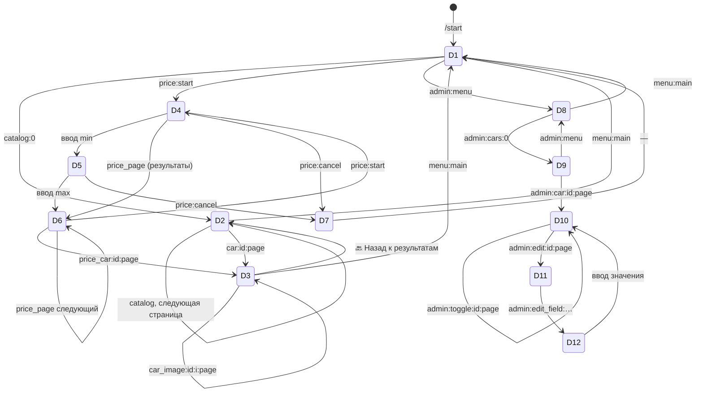
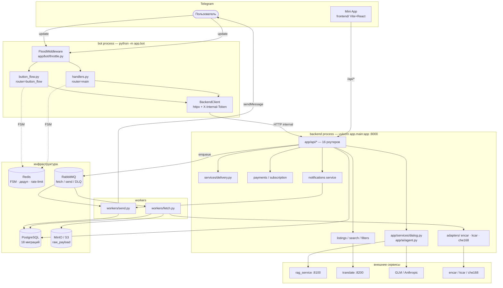
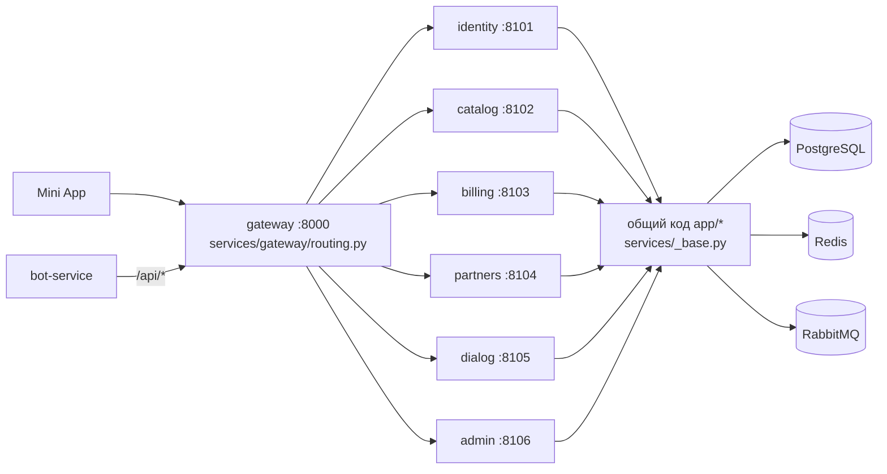
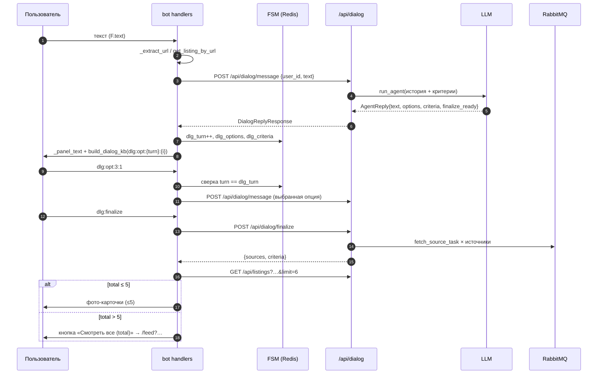
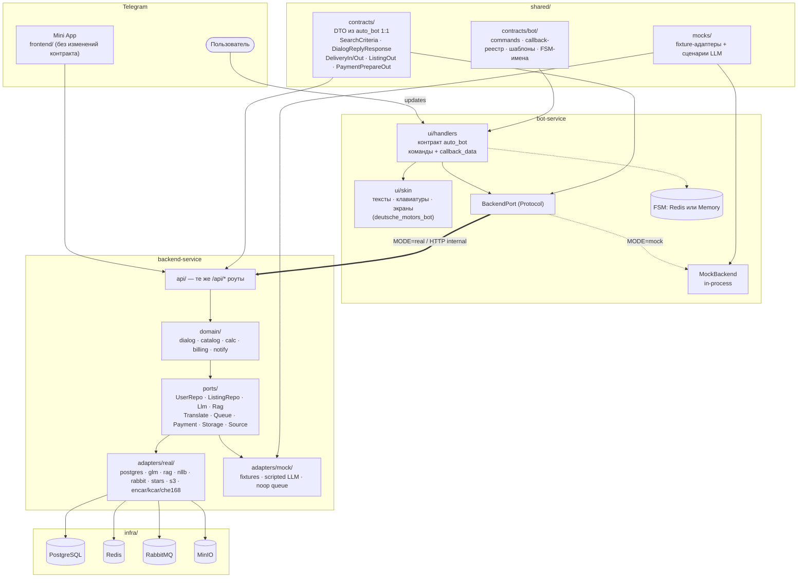
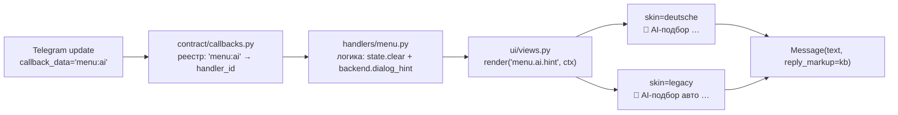

# Этап 1 — Анализ двух проектов, карта контракта и план миграции

**Проект:** объединение `auto_bot` (логика + замороженный контракт) и `deutsche_motors_bot` (UI/UX)
**Источники:** `C:\Users\New\Desktop\Проекты\auto_bot`, `C:\Users\New\Desktop\Проекты\deutsche_motors_bot` (read-only)
**Статус:** анализ завершён, код не писался. Ждём подтверждения перед Этапом 2.

---

## 0. Термины и как читать документ

| Термин | Значение в этом документе |
|---|---|
| **Контракт** | Всё, что наблюдает внешний клиент: имена команд, значения `callback_data`, тип и структура сообщения (HTML, наличие `reply_markup`, наличие фото, лимит caption), схемы HTTP-payload'ов, имена задач очередей, имена FSM-состояний, deep-link-параметры. |
| **UI/UX** | Тексты, эмодзи, порядок шагов, раскладка кнопок, тон, визуальные паттерны (фото-карточка, счётчик `N/M`, пагинация, «назад/в меню»). |
| **BL** | Доменная логика: подбор, диалог с LLM, калькулятор, биллинг, уведомления. |
| **Skin** | Сменный UI-слой: подменяет тексты и раскладку, не трогая `callback_data` и обработчики. |

Ключевое разделение, на котором держится весь план: **`auto_bot` — источник контракта, `deutsche_motors_bot` — источник оформления.** Обратное неверно: `callback_data` из `deutsche_motors_bot` (`catalog:0`, `price:start`, `car:{id}:{page}`, `admin:*`, `menu:main`) — это **не наш контракт**, а чужой синтаксис. Он добавляется как новый (совместимое расширение), но не заменяет существующий.

---

## 1. Что фактически прочитано

### 1.1. `auto_bot` — текущий бот (источник контракта)

| Слой | Файлы | Роль |
|---|---|---|
| Бот | `app/bot/handlers.py` (1264 строки), `button_flow.py`, `client.py`, `throttle.py`, `__main__.py` | Telegram-клиент. Своей БД не имеет — только HTTP в backend |
| Backend | `app/main.py` + 16 роутеров `app/api/*.py` | FastAPI, `:8000` |
| Домен | `app/services/*` (23 модуля), `app/ai/*`, `app/adapters/*` (encar/kcar/che168) | BL, LLM-агент, парсеры |
| Данные | `app/db/models.py`, 18 миграций Alembic | PostgreSQL |
| Очереди | `app/queue/rabbit.py`, `app/workers/fetch.py`, `app/workers/send.py` | RabbitMQ: очереди `fetch`, `send`, `dead_letter` |
| Прочее | `services/` (gateway `:8000`, identity `:8101`, catalog `:8102`, billing `:8103`, partners `:8104`, dialog `:8105`, admin `:8106`, `rag`, `translate`), `frontend/` (Mini App), `docker-compose.yml` (профили `mono` / `micro`) | Уже существует частичное микроразделение через gateway |
| Тесты | 55 файлов `tests/test_*.py` | Включая `test_bot_dialog_ui.py` — зачаток UI-контрактных проверок |

Существенное наблюдение: **в `auto_bot` уже есть профиль `micro`** — gateway проксирует `/api/*` в 6 доменных сервисов, а сервисы переиспользуют те же роутеры из `app/api/*` (`services/_base.py`). То есть «разделить на микросервисы» — не стройка с нуля, а доведение существующего разделения до требуемого вида: добавить отдельный `bot-service`, вынести `shared/contracts`, ввести port/adapter с `mock|real` и профили `bot-only|backend-only|all`.

### 1.2. `deutsche_motors_bot` — эталон UI/UX (read-only)

Компактный aiogram 3 + SQLAlchemy + SQLite, 4 роутера (`start`, `catalog`, `price`, `admin`), 2 FSM-группы (`PriceSelection`, `CarEdit`), парсинг-мод `HTML`. Все тексты — в коде, вынесены в константы/литералы. Стиль: одна «живая» панель (`edit_text` вместо новых сообщений), пагинация по 4 карточки, фото-карточка с навигацией `⬅️ 📷 2/5 ➡️`, аккуратные `callback.answer(..., show_alert=True)` на ошибках.

---

## 2. Карта контракта `auto_bot` — «замороженный» контракт

### 2.1. Команды

| Команда | Аргументы | Обработчик | Ответ (структура) |
|---|---|---|---|
| `/start` | `deep_link` | `cmd_start` | `upsert_user` → deep link ИЛИ `START_TEXT` + `build_main_menu_kb()` |
| `/menu` | — | `cmd_menu` | `"Меню:"` + меню |
| `/help` | — | `cmd_help` | `HELP_TEXT` + меню |
| `/reset` | — | `cmd_reset` | `dialog_reset` → `"Диалог сброшен. Начните заново — опишите, какую машину ищете."` |
| `/stop` | — | `cmd_stop` | `notify_mode=off` → `"🔕 Уведомления отключены. /resume — включить обратно."` |
| `/resume` | — | `cmd_resume` | `notify_mode=digest` → 3 варианта ответа (вкл. / нет фильтров / backend недоступен) |
| `/subscribe` | — | `cmd_subscribe` | статус тарифа + 3 кнопки `sub:buy:*` |
| `/calc` | `цена [объём] [vs ...]` | `cmd_calc` | смета `_format_calc_out` или сравнение `_format_compare_out` |

Зарегистрированный список `set_my_commands` (visible в Telegram): `start`, `calc`, `menu`, `reset`, `help`, `stop`.
Кнопка-меню чата: `MenuButtonWebApp("🚗 Поиск авто", MINIAPP_URL)` — только при `https://`.

### 2.2. Реестр `callback_data`

| Шаблон | Разбор | Обработчик | Примечание |
|---|---|---|---|
| `menu:ai` | `action=ai` | `main_menu_callback` | сброс FSM + `MENU_AI_HINT` + кнопка `dlg:restore` |
| `menu:compare` | — | то же | текст + `_miniapp_kb("/compare")` |
| `menu:calc` | — | то же | текст + `_miniapp_kb()` |
| `menu:notify` | — | то же | 4 кнопки: `menu:notify_set:*`, `menu:quiet` |
| `menu:notify_set:{instant\|digest\|off}` | 2 сегмента | то же | `backend.notification_settings` |
| `menu:quiet` | — | то же | 3 кнопки `menu:quiet_set:*` |
| `menu:quiet_set:{23:00-08:00\|22:00-10:00\|off}` | **3 сегмента** (`:` внутри значения) | то же | разбор через `split(":", 1)` |
| `menu:subscribe` | — | то же | реюз `cmd_subscribe` |
| `menu:reset` | — | то же | сброс + меню |
| `menu:help` | — | то же | `HELP_TEXT` + меню |
| `dlg:reset` | — | `dlg_callback` | `edit_text` (fallback `answer`) + меню |
| `dlg:restore` | — | то же | `dialog_restore` → история или отказ |
| `dlg:finalize` | — | то же | `dialog_finalize` → «✅ Поиск запущен», затем карточки (≤5) или лента `total>5` |
| `dlg:opt:{turn}:{idx}` | 4 сегмента | то же | **токен хода**; устаревший `turn` → alert «Эта кнопка уже устарела» |
| `analyze:{listing_id}` | 2 сегмента | `analyze_from_card` | «🤖 Анализ цены»; 403 → апселл Pro |
| `calc:{listing_id}` | 2 сегмента | `calc_from_card` | «🚚 Доставка и растаможка» |
| `sub:buy:{tier}:{days}` | 4 сегмента, `tier∈{pro,business}`, `days∈{30,365}` | `sub_buy` | `prepare_payment` → `answer_invoice(XTR)` |
| `btn:{field}:{idx}` | `field∈{make,year,budget,reset}` | `btn_click` | кнопочный fallback при недоступной LLM |

Неявные контракты этого реестра, которые легко сломать:

1. **Токен хода** в `dlg:opt:{turn}:{idx}` — защита от двойных кликов при мультивыборе. Индекс `idx` валиден только для текущего `dlg_turn` из FSM.
2. **`menu:quiet_set:23:00-08:00`** содержит `:` внутри значения → разбор обязан быть `split(":", 1)`, а не `split(":")`.
3. **`dlg:finalize`** различает «мало результатов» (`total ≤ 5` → фото-карточки) и «много» (`total > 5` → кнопка ленты с `urlencode(params)`).
4. `dlg:opt` при несовпадении `turn` отвечает **alert без изменения сообщения** — иначе панель «съедет».

### 2.3. Форматы сообщений (шаблоны)

| # | Шаблон | Структура (контракт) | Текст (UI — заменяем) |
|---|---|---|---|
| M1 | `START_TEXT` | HTML, 4 абзаца + `<i>` пример | приветствие «Я Артём…» |
| M2 | `HELP_TEXT` | `<b>Команды:</b>` + список + 2 строки | справка |
| M3 | `MENU_AI_HINT` | HTML + `<i>` | подсказка диалога |
| M4 | Панель диалога | `reply.text` (экранируется) + `\n\n📋 <b>Параметры поиска:</b>\n` + `format_criteria` | — |
| M5 | `format_criteria` | строки `• Метка: <b>значение</b>`; страна → флаг; цены/пробег с пробелами; `sources` отдельной строкой | — |
| M6 | `build_listing_caption` | `<b>title</b>` + `💰` + `⚙️ body · year · mileage · VIN` + `📍 Источник:` , **≤1024 символа** | — |
| M7 | `_format_calc_out` | `🚚 <b>Расчёт «под ключ»</b>` + шапка + `• Компонент: N ₽` + `Итого` + `⚠️ util_note` + `<i>дисклеймер</i>` | — |
| M8 | `_format_compare_out` | медали 🥇🥈🥉 + дельта `(+N $)` + `<i>дисклеймер</i>` | — |
| M9 | `_format_analysis` | `🤖 <b>AI-анализ стоимости</b>` + цена + рынок + вердикт (`deal/fair/overpriced` → 🟢🟡🔴) + диапазон + дельта % + summary + ≤4 фактора + `<i>апселл</i>` | — |
| M10 | Тарифы | `Текущий тариф: <b>{tier}</b>` + до даты + Pro/Business + 3 кнопки | — |
| M11 | Push-карточка | `format_listing_card`: `🚗 <b>title</b>` / `💰` / `📏` / `🔗 Source` / URL | — |
| M12 | Push-статус | `format_status_card`: `⬇️ Цена снизилась: было → стало` / `✅ Снова в продаже` / `🔴 Объявление исчезло с источника` + карточка | — |
| M13 | Ошибки | `"Backend недоступен, попробуйте позже."`, `"😔 AI-анализ недоступен — уже разбираюсь…"`, глобальный `"😔 Что-то пошло не так…"` | — |

Инварианты, которые **нельзя** менять: `parse_mode=HTML`; caption ≤ 1024; ≤ 5 фото-карточек за раз; ≤ 8 опций в панели (`options[:8]`); ≤ 6 inline-кнопок по ТЗ §5.8; эмодзи-префиксы как семантические маркеры (их проверяют тесты).

### 2.4. FSM-состояния и ключи данных

| Хранилище | Ключ / состояние | Содержимое |
|---|---|---|
| Redis | `fsm:{user_id}` | `RedisStorage.from_url(REDIS_URL)` |
| `ButtonForm` | `make`, `model`, `year`, `budget` | кнопочный fallback |
| FSM data | `panel_msg_id` | id «живой» панели для `edit_message_text` |
| FSM data | `dlg_turn`, `dlg_options`, `dlg_criteria` | токен хода, опции, критерии |
| FSM data | `make`, `model`, `year_from`, `year_to`, `price_min`, `price_max`, `country`, `created_from_dialog` | сборка `SearchCriteria` для `dialog_finalize` |

`deutsche_motors_bot` содержит `PriceSelection` и `CarEdit` — их имена **не** становятся частью контракта `auto_bot` (новое пространство), но `auto_bot`-состояния должны сохранить имена: они попадают в Redis и в логи, а `test_bot_dialog_ui.py` уже опирается на поведение.

### 2.5. HTTP API (публичный контракт)

Роутеры и префиксы (16 файлов `app/api/*.py`):

| Префикс | Методы | Доступ |
|---|---|---|
| `/api/auth` | `POST /telegram`, `POST /magic-link` (501), `POST /telegram/link`, `GET /telegram/link/{code}`, `POST /telegram/link/confirm`, `POST /refresh`, `POST /register`, `POST /guest`, `POST /login` | JWT / публично |
| `/api/users` | `POST /upsert` | internal |
| `/api/me` | `GET /me`, `POST /me/onboarded` | JWT |
| `/api/filters` | `GET`, `POST`, `PATCH /{id}`, `DELETE /{id}` | JWT |
| `/api/listings` | `GET`, `GET /facets`, `GET /by-url`, `GET /{id}`, `GET /{id}/inspection`, `PUT /{id}/inspection`, `POST /{id}/analysis`, `GET /{id}/analysis` | публично / admin |
| `/api/bot/listings` | `POST /{id}/analysis` | **internal**, 403 = квота |
| `/api/calc` | `POST /delivery`, `POST /compare` | публично |
| `/api/favorites`, `/api/listings/{id}/favorite` | `GET`, `POST`, `DELETE` | JWT |
| `/api/payments`, `/api/subscription`, `/api/users/{id}/subscription` | `POST /prepare`, `POST /success`, `POST /stars`, `GET` | internal / JWT |
| `/api/admin` | `adapters`, `leads`, `sources`, `sources/{name}`, `…/health`, `…/fetch`, `assistant/chat`, `listings/{id}/raw`, `analytics/funnel`, `analytics/retention` | internal |
| `/api/dialog` | `POST /message`, `/restore`, `/reset`, `/finalize` | **internal** |
| `/api/ai` | `POST /message`, `/reset`, `/finalize` | internal |
| `/api/notifications` | `POST /settings`, `POST /scan` | internal |
| `/api/leads` | `POST`, `PATCH /{id}` | internal |
| `/api/admin/partners`, `/api/partner` | CRUD, `me`, `leads`, `leads/batch`, `billing`, `leads/{id}/claim`, `leads/{id}/feedback` | internal / partner-key |
| system | `GET /health`, `GET /health/detailed`, `GET /metrics` | публично |

Внутренние вызовы защищены заголовком `X-Internal-Token` (`check_internal_token`, fallback на `APP_SECRET_KEY`). Это часть контракта: бот ходит только с ним.

Ключевые DTO (переносятся в `shared/contracts` **без изменений**):

- `DialogReplyResponse{session_id, text, options[], status, finalize_ready, turn_count, criteria}`
- `SearchCriteria{make, model, generation, year_from, year_to, price_min, price_max, currency, mileage_max, fuel, transmission, drive, body_type, color, engine_volume_min, engine_volume_max, country, sources[], location, not_damaged, no_accidents, seller_type, notes, created_from_dialog, dialog_session_id}`
- `DeliveryIn{price_usd>0, engine_cc 50..10000, year 1980..2100, power_hp?, region: ru|by}` → `DeliveryOut{…, components[], legal_refs[], total_rub, total_usd, total_local, rates_note}`
- `NotifySettingsIn{user_id, notify_mode: instant|digest|off|None, quiet_hours, quiet_hours_clear}`
- `PaymentPrepareOut{payment_id, amount, tier, period_days, title, description}`; `PaymentSuccess` → `{tier, subscription_until}` (+ идемпотентность `paid`)
- `ListingOut`, `ListingListOut{total, items[]}`, `UnifiedListing`, `SourceConfig`, `SourceHealth`

### 2.6. События и очереди

| Обменник/очередь | Задача | Аргументы | Потребитель |
|---|---|---|---|
| exchange (routing_key = имя задачи) | `fetch_source_task` | `(source_name, criteria?, max_pages?)` | `workers/fetch.py` |
| | `notify_new_listings` | `(source_name?)` | `workers/send.py` |
| | `listing_status_scan` | `(kind, listing_ids)` | `workers/send.py` |
| | `translate_listings` | `(source_name, chunk)` | `workers/fetch.py` |
| `fetch` / `send` | — | — | очереди |
| `dead_letter` | — | — | DLQ после `MAX_ATTEMPTS` |

Имена задач — контракт: они маршрутизируются по `routing_key`, публикуются и из API (`/api/admin/sources/{name}/fetch`, `/api/notifications/scan`), и из воркеров.

### 2.7. Внешние интеграции и прочие контракты

- **Deep links:** `listing_{id}` (карточка), `filter_{id}` (сообщение + Mini App), `login_{code}` (веб-вход, TTL 15 мин), `ref_{uid}` (только лог). `app` объявлен в ТЗ §5.3, но **не реализован** — фиксирую как расхождение, к переносу не обязателен.
- **Inline-режим:** запрос `listing:<id>` (регэксп `^listing[_\-\s]?(\d+)$`) → `InlineQueryResultArticle` с `id="listing_{id}"`, `thumbnail_url` только `.jpg/.jpeg`, кнопки `t.me/{bot}?startapp=listing_{id}` + ссылка на источник.
- **Оплата:** `LabeledPrice`, `currency="XTR"`, поле `provider_token` — пустая строка (Stars не требует провайдера), `payload="sub:{payment_id}"`, `pre_checkout_query → ok=True`, `successful_payment → /api/payments/success` (+идемпотентность).
- **Mini App:** `web_app` только для `https://`, иначе `url`-кнопка (тест это фиксирует); deep-link в приложение `?startapp=listing_{id}`.
- **Throttle:** `FloodMiddleware` на `message` и `callback_query` (скользящее окно).

### 2.8. Что НЕ является контрактом (можно менять свободно)

Тексты и эмодзи внутри шаблонов; раскладка и порядок кнопок; порядок шагов сбора; форматирование чисел внутри текста; внутренние имена модулей/классов; структура БД (за миграциями); конкретные модели LLM; наличие/отсутствие `send_chat_action`; служебные логи.

---

## 3. UI/UX-инвентарь `deutsche_motors_bot`

### 3.1. Экраны

| ID | Экран | Триггер | Текст | Клавиатура |
|---|---|---|---|---|
| D1 | Welcome / главное меню | `/start`, `menu:main` | «🚘 **Deutsche Motors**\n\nНемецкое качество в богатых комплектациях напрямую из Южной Кореи.\n\nВыберите интересующий вас вариант:» | `🚗 Выбрать машину` → `catalog:0`; `💰 Подобрать по цене` → `price:start`; опц. `🔐 Админка` → `admin:menu` |
| D2 | Каталог | `catalog:{page}` | «🚗 **Доступные автомобили**\n\nВыберите интересующий автомобиль:» | по кнопке на авто (`car:{id}:{page}`), `➡️ Далее`, `🔙 В главное меню` |
| D3 | Карточка авто | `car:{id}:{page}` | `format_car_card`: `🚘 **Brand Model Gen**` / `📅 Год` / `🛣 Пробег` / `⛽ Топливо` / `🔧 Двигатель` / `⚙️ Привод` / `🔄 КПП` / `🚗 Кузов` / `📝 Описание` / `💰 **N $**` | навигация фото `⬅️ · 📷 1/N · ➡️` (`car_image:{id}:{i}:{page}`), `🔙 Назад к результатам`, `🔙 В главное меню` |
| D4 | Подбор по цене — шаг 1 | `price:start` | «💰 **Подбор автомобиля по цене**\n\nВведите минимальную цену в USD.\n\nНапример: `40000`» | `❌ Отмена`, `🔙 В главное меню` |
| D5 | Шаг 2 (max) | после min | «💰 Теперь введите максимальную цену в USD.\n\nНапример: `70000`» | то же |
| D6 | Результаты подбора | после max / `price_page:{page}` | «💰 **Подходящие автомобили**\n\nЦена: **A–B $**\n\nВыберите автомобиль:» | `price_car:{id}:{page}`, `➡️ Далее`, `💰 Изменить цену`, `🔙 В главное меню` |
| D7 | Отмена подбора | `price:cancel` | «❌ **Подбор по цене отменён.**\n\nВыберите действие:» | главное меню |
| D8 | Админ-меню | `admin:menu` | «🔐 **Админ-панель**\n\nВыберите раздел:» | `🚗 Автомобили` (`admin:cars:0`), `📷 Фотографии`, `🔙 В главное меню` |
| D9 | Админ-список | `admin:cars:{page}` | «🚗 **Автомобили**\n\n🟢 — … клиентам\n🔴 — … скрыт\n\nВыберите автомобиль:» | `🟢/🔴 Brand Model` (`admin:car:{id}:{page}`), `➡️ Далее`, `🔙 В админку` |
| D10 | Админ-карточка | `admin:car:{id}:{page}` | `format_admin_car` (+`💵 Цена BYN`, `**Статус:**`) | `🔴 Скрыть / 🟢 Вернуть`, `✏️ Редактировать`, `📷 Фотографии`, `🔙 К списку`, `🔙 В админку` |
| D11 | Редактирование — выбор поля | `admin:edit:{id}:{page}` | «✏️ **Редактирование**\n\n🚘 {title}\n\nВыберите поле, которое хотите изменить:» | 13 полей (`admin:edit_field:{id}:{field}:{page}`) + `🔙 Назад` |
| D12 | Ввод значения поля | `admin:edit_field:…` | «✏️ **Изменение поля**\n\nПоле: **{name}**\nТекущее значение: `{v}`\n\nВведите новое значение:» | `❌ Отмена` |

### 3.2. Граф переходов

### 3.3. UI-паттерны, которые забираем

1. **Одна живая панель** — `edit_text`/`edit_media` вместо потока новых сообщений (в `auto_bot` это уже есть через `panel_msg_id`, паттерн подтверждаем).
2. **Фото-карточка** — `answer_photo` с caption + навигация `⬅️ 📷 N/M ➡️` и кнопка `noop` на счётчике.
3. **Пагинация по 4** с `limit = per_page + 1` для определения `has_next` — без `COUNT`.
4. **Навигация «назад» двух уровней** — «к результатам» и «в главное меню».
5. **Ошибки через `show_alert=True`**, а не новым сообщением.
6. **Валидация ввода** — человеческие тексты ошибок (`❗ Цена не может быть отрицательной`), а не коды.
7. **Тон** — короткие фразы, эмодзи-маркер на строку, «вы» с маленькой, никакого CAPS.

---

## 4. Схема `auto_bot` AS-IS

### 4.1. Компоненты и зависимости

### 4.2. Профиль `micro` (уже существующий)

### 4.3. Последовательность: AI-диалог

---

## 5. Целевая схема микросервисов

### 5.1. Компоненты

### 5.2. Режимы запуска (матрица)

| `SERVICE` | `MODE` | Что поднимается | Зависимости | Назначение |
|---|---|---|---|---|
| `bot` | `mock` | только `bot-service` + `MockBackend` в процессе + `MemoryStorage` | нет | UI-разработка, демо, прогон экранов без бэка |
| `bot` | `real` | `bot-service` + HTTP в `backend-service` | `backend-service` | штатный |
| `backend` | `mock` | только `backend-service` (fixtures, scripted LLM, noop queue) | нет | разработка домена, контрактные тесты |
| `backend` | `real` | `backend-service` + PG/Redis/Rabbit/S3 | инфраструктура | штатный |
| `all` | любой | `bot-service` + `backend-service` + инфраструктура | всё | полный стек |

`MODE` допускает per-port override: `MODE=mock` + `ADAPTER_LLM=real` — то есть «всё мокнуто, кроме LLM». Это закрывает требование «переключение только через ENV, без правки кода».

### 5.3. Границы сервисов и их контракты

| Сервис | Зона ответственности | Входящий контракт | Исходящий контракт |
|---|---|---|---|
| `bot-service` | Telegram UI, FSM, рендер сообщений | updates Telegram; `BCT`-реестр | `BackendPort` (HTTP internal, те же `/api/*`) |
| `backend-service` | домен + BL + оркестрация | те же `/api/*` (схемы 1:1) | порты: repo/llm/rag/queue/payment/storage/source |
| `shared/contracts` | DTO + реестр бота | — | библиотека |
| `shared/mocks` | детерминированные подделки | — | библиотека |
| `infra` | compose-профили, Makefile, ENV-матрица | — | — |

**Правило, которое проверяется тестом:** ни один файл в `bot-service/` не импортирует `sqlalchemy`, `aio_pika`, `boto3`, `redis` (кроме FSM-стораджа) и адаптеры `real/`. Ни один файл в `backend-service/domain/` не импортирует `aiogram` и `httpx`-клиенты конкретных провайдеров.

### 5.4. Точка расширения UI (skin)

Смысл: `callback_data` и обработчик не зависят от текста. Тексты — в `ui/skin/deutsche_motors_bot/*.py` как словарь. Это даёт две вещи: (а) UI можно менять без риска для контракта; (б) golden-тесты могут прогонять оба скина на одном реестре.

---

## 6. Матрица маппинга: экран `auto_bot` → UI `deutsche_motors_bot` → сохраняемый контракт

| # | Экран `auto_bot` (AS-IS) | Контракт AS-IS — не менять | UI/UX из `deutsche_motors_bot` — берём | Итог |
|---|---|---|---|---|
| 1 | `/start` → `START_TEXT` + меню на 5 рядов (7 `callback_data` + опц. кнопка Mini App) | `START_TEXT`-структура: HTML, приветствие + пример + меню; `menu:*` все достижимы; `build_main_menu_kb()` состав | D1: короткий welcome, крупная кнопка-действие, «Выберите вариант:»; принцип «2 кнопки на главном, остальное — глубже» | **Главный экран = D1-стиль:** `🚗 AI-подбор авто` (`menu:ai`) + `📱 Открыть приложение`; второй ряд — `💰 Калькулятор` (`menu:calc`), `⚖️ Сравнить` (`menu:compare`); третий — `🔔/⭐/🔄/❓` (`menu:notify/subscribe/reset/help`). Все 7 `callback_data` сохранены (плюс опциональная кнопка Mini App), тексты и раскладка — deutsche. **Текст заменяется, структура — нет** (см. D1 в §8). Компактный вариант (2 кнопки + «⚙️ Ещё») — по решению D2. |
| 2 | `menu:ai` → `MENU_AI_HINT` + `dlg:restore` | `MENU_AI_HINT` + кнопка `dlg:restore` | D1-тон: одно действие, одна подсказка, пример в `<i>` | Текст переписан в тоне deutsche («Опишите, что ищете — подберу…»), `callback_data` не тронут |
| 3 | Панель диалога `dlg` | `_panel_text` = `reply.text` + `📋 Параметры поиска:` + `format_criteria`; `build_dialog_kb`: опции → `dlg:finalize` → miniapp → `dlg:reset`; токен хода | D3-паттерн «паспорт объекта»: строки `эмодзи + Подпись: значение`; D4-D5 «Шаг N/M» | `format_criteria` переоформлен в стиле `📅 Год: …` (пункт-в-пункт), но **порядок полей, набор `_FIELD_LABELS` и `sources`** сохранены. Кнопки опций остаются `dlg:opt:{turn}:{i}` |
| 4 | `dlg:restore` → история | `_format_history` (`👤 Вы:` / `🤖 Бот:`, обрезка 160) | D1-тон «Вернул прошлый диалог» | Оформление — deutsche, формат истории — прежний |
| 5 | `dlg:finalize` → «✅ Поиск запущен» + карточки/лента | Ветка `total ≤ 5` → `_send_car_cards`; `total > 5` → кнопка `/feed?qs`; при `total == 0` — текст про сохранённый фильтр | D2-список и счётчик результатов; `_plural` остаётся | Тексты — deutsche, логика ветвления — строго прежняя |
| 6 | Карточка объявления: `answer_photo` + `build_listing_caption` + `_car_card_kb` | caption ≤1024, состав строк, `🔗 Открыть объявление` + пара `analyze:{id}`/`calc:{id}` + miniapp | **D3 целиком**: `📅/🛣/⛽/🔧/⚙️/🔄/🚗/📝/💰`, навигация `⬅️ 📷 N/M ➡️` (`noop`), `🔙 Назад к результатам`, `🔙 В главное меню` | Визуал — D3; ряды `analyze/calc` сохраняются как контракт. Новые кнопки навигации получают **новые** `callback_data` (`card:back`, `card:home`), старые не удаляются |
| 7 | `analyze:{id}` → `_format_analysis` | Вердикты `deal/fair/overpriced` → 🟢🟡🔴; блоки цена/рынок/диапазон/дельта/факторы; `quota_exceeded` → апселл | D10-паттерн «карточка с блоками» и `_format_car_card`-ритм | Структура блоков сохранена, формулировки — deutsche |
| 8 | `calc:{id}` / `/calc` → `_format_calc_out` | Смета: `• Компонент: N ₽`, `Итого`, `⚠️ util_note`, дисклеймер; `region` | D6-паттерн заголовка и «Цена: **A–B**» | Порядок строк и обязательные блоки сохранены |
| 9 | Сравнение `/calc A vs B` → `_format_compare_out` | Медали, дельта к лучшему, дисклеймер | Медальный ритм из deutsche не нужен — берём `💰/📊`-акценты | Без изменений контракта; текст ближе к deutsche |
| 10 | `menu:notify` → 4 кнопки режимов | `menu:notify_set:{instant\|digest\|off}`, `menu:quiet` | D8/D9-паттерн двухуровневого меню + «🔙 В главное меню» | Кнопки сохранены, добавлен `🔙 В главное меню` (`menu:help`-независимый, новый `menu:main`) |
| 11 | `menu:quiet` → 3 интервала | `menu:quiet_set:23:00-08:00` и др. (**3 сегмента**) | тот же двухуровневый вид | Разбор `split(":",1)` — обязателен, иначе контракт ломается |
| 12 | `/subscribe` + `sub:buy:{tier}:{days}` | 3 тарифа, `_tier_label`, `XTR`, `payload="sub:{id}"` | D8-вид: заголовок-блок + строки с `⭐` | Тексты deutsche, суммы/`callback_data` — как было |
| 13 | `/stop`, `/resume`, `/reset` | 3 разные реакции на `resume` | D1 «Выберите действие:» + меню | Тексты deutsche |
| 14 | `btn:*` кнопочный fallback (марка/модель/годы/бюджет) | `ButtonForm{make,model,year,budget}`, `btn:{field}:{idx}`, `_STEP_TOTAL=4` | **D4–D6: «Шаг N/M»**, `❌ Отмена`, `💰 Изменить` | Прогресс-строка — в стиле D4; шаги и `callback_data` — как было |
| 15 | `catalog:0` — **нет в `auto_bot`** | — | **D2 каталог** (пагинация 4, `➡️ Далее`) | Новый экран поверх существующего `GET /api/listings` (без изменений API). `callback_data` — новый, конфликтов нет |
| 16 | «Подобрать по цене» — **нет в `auto_bot`** | — | **D4–D7**: min → max → результаты → «Изменить цену» | Новый UX поверх `GET /api/listings?price_min&price_max`; FSM-группа `PriceSelection` — новое пространство имён |
| 17 | Бот-админки нет (есть веб-админка `frontend/src/admin`) | — | **D8–D12**: меню, список 🟢/🔴, карточка, 13 полей, ввод значения | Перенос **опционален** (`admin:*` за фича-флагом). Требует решения: дублирует веб-админку (Q1) |
| 18 | deep links `listing_/filter_/login_/ref_` | Все 4 префикса + тексты ошибок `login_` | D3-оформление карточки | Сохраняется 1:1 |
| 19 | inline `listing:<id>` | `InlineQueryResultArticle`, `thumbnail_url` только jpeg | — | Без изменений |
| 20 | Уведомления (push): instant/digest/status | `format_listing_card` (🚗/💰/📏/🔗/url), `format_status_card` (⬇️/✅/🔴) | D3-ритм строк | Тексты ближе к D3, обязательные строки сохранены |
| 21 | `menu:main` — **нет в `auto_bot`** | — | D1/D2: `🔙 В главное меню` | ⚠️ Попадает в `F.data.startswith("menu:")` → нужна **явная ветка** `action == "main"`, иначе молчаливый no-op |

### 6.1. Проверка на коллизии `callback_data`

| Пространство | `auto_bot` | `deutsche_motors_bot` | Конфликт |
|---|---|---|---|
| `menu:` | `ai, compare, calc, notify, notify_set:*, quiet, quiet_set:*, subscribe, reset, help` | `main` | **Пересечение префикса**, значения не совпадают → нужна ветка `main` |
| `dlg:` | `reset, restore, finalize, opt:*` | — | нет |
| `btn:` | `{make,year,budget,reset}:{idx}` | — | нет |
| `analyze:` / `calc:` | `{listing_id}` | — | нет |
| `sub:buy:` | `{tier}:{days}` | — | нет |
| `admin:` | — | `menu, cars:*, car:*, toggle:*, edit:*, edit_field:*, photos*` | нет |
| `catalog:` / `car:` / `car_image:` / `price:` / `price_page:` / `price_car:` | — | свои форматы | нет |

Итог: ровно одна коллизия — `menu:main`. Она решается одной ветвью в `main_menu_callback` и покрывается тестом.

---

## 7. План миграции по шагам и точки отката

Принцип: каждый шаг заканчивается проверяемым состоянием; откат — либо `git revert`, либо переключение ENV. Код `auto_bot` до шага M6 остаётся рабочим и деплоимым.

| Шаг | Что делаем | Проверка (DoD) | Точка отката |
|---|---|---|---|
| **M0** | Фиксация контракта: снять `openapi.json` из `app.main:app`, реестр `callback_data`, шаблоны (рендер на фикстурах), имена FSM и задач очередей. Артефакты — в `shared/contracts/golden/`. Код `auto_bot` не меняется | Golden-файлы закоммичены, прогон по `auto_bot` даёт те же значения | Не требуется (read-only) |
| **M1** | `shared/contracts`: перенос DTO (`criteria`, `listing`, `dialog`, `payment`, `notify`) **копированием без правок**. `auto_bot` начинает импортировать из `shared` (thin re-export), поведение не меняется | Все 55 тестов `auto_bot` зелёные; `test_contract` сравнивает импортируемые схемы с golden | `R1`: revert коммита; DTO остаются в `app/schemas` |
| **M2** | `backend-service`: `ports/` (Protocol) + `adapters/real/*` (делегируют в существующие `app/services`, `app/adapters`) + `adapters/mock/*` (fixtures). Переключение `MODE`/`ADAPTER_*` | `MODE=mock` поднимает бэк без PG/Redis/Rabbit; `MODE=real` проходит `openapi`-дифф с `auto_bot` = 0 | `R2`: `SERVICE=bot` + старый `app.main:app` на `:8000` |
| **M3** | `bot-service`: перенос `handlers.py`/`button_flow.py` 1:1 по `callback_data`, `BackendClient` → `BackendPort`; скин `deutsche` подключён, но пока как «второй словарь» | `test_contract` на реестре: каждый `callback_data` из golden отвечает тем же типом сообщения; бот работает с `MODE=mock` и `MODE=real` | `R3`: вернуть `app/bot` (старый процесс) — оба используют один `BOT_TOKEN`, поэтому параллельно не запускаются (см. §7.1) |
| **M4** | Наложение UI по матрице §6 (экраны 1–14), экран за экраном. Каждый экран — отдельный коммит + snapshot-тест рендера | Для каждого экрана: `text`/`reply_markup` совпадают с эталоном deutsche; `callback_data` — с golden | `R4`: per-screen revert; скин `legacy` остаётся доступным по `SKIN=legacy` |
| **M5** | Новые экраны из deutsche: `catalog:` (D2), `price:*` (D4–D7), `menu:main`. Админка — по решению Q1 | `make test-contract` зелёный; `catalog:`/`price:*` отвечают, `menu:main` возвращает D1 | `R5`: отключить новые роутеры флагом `FEATURE_DEUTSCHE_SCREENS=false` |
| **M6** | `docker-compose` профили `bot-only`/`backend-only`/`all`, `Makefile` (`up-bot`, `up-backend`, `up-all`, `test-contract`), ENV-матрица, README | `make up-bot` (SERVICE=bot, MODE=mock) — бот кликается целиком; `make up-backend` (SERVICE=backend) — `/health/detailed` 200; `make up-all` — полный стек; `make test-contract` — зелёный | `R6`: `git revert` M6; развёртывание старым `docker-compose` с профилем `mono` |
| **M7** | Cutover: новый бот получает боевой `BOT_TOKEN`, старый останавливается | E2E «клиент не замечает разницы»: скрипт проходит 14 сценариев старого бота | `R7`: вернуть `BOT_TOKEN` старому процессу (см. §7.1) |

### 7.1. Откат на уровне Telegram (важно)

Telegram допускает **одного** потребителя `getUpdates` на токен. Параллельный прогон двух ботов на одном токене невозможен: один будет получать `409 Conflict` и «съедать» апдейты другого. Поэтому:

- этапы M3–M6 проверяются на **отдельном тестовом боте** (`TEST_BOT_TOKEN`) — старый прод не трогаем;
- откат M7 = остановить новый процесс → вернуть `BOT_TOKEN` старому → `delete_webhook(drop_pending_updates=False)`. Потеря апдейтов — секунды;
- данные общие (одна PG), потому что `shared/contracts` и миграции не менялись: откат не требует откатывать БД.

### 7.2. Что проверяется на каждом шаге (сводно)

| Проверка | Где | Когда |
|---|---|---|
| `pytest tests/` (55 файлов) | `auto_bot` | M1, после каждого переноса |
| `openapi`-дифф `auto_bot` vs `backend-service` (0 расхождений) | `make test-contract` | M2+ |
| Реестр `callback_data` ⊆ golden | `make test-contract` | M3+ |
| Snapshot текстов/клавиатур по экранам | `make test-contract` | M4+ |
| `bot-service` без импортов `sqlalchemy`/`aio_pika`/адаптеров | `test_layering` | M3+ |
| `MODE=mock` без инфраструктуры | CI job | M2+ |
| E2E 14 сценариев «старый клиент» | `test-e2e` | M6+ |

---

## 8. Решения, требующие подтверждения

### D1. Где граница между «байт-в-байт» и «взять UI/UX»

Требования 1 и 2 формально конфликтуют: тексты — часть сообщений, но тексты же нужно заменить на deutsche. Предлагаемое разделение (и оно же — основа плана):

- **Байт-в-байт:** `callback_data`, имена команд, имена FSM-состояний, схемы HTTP, имена задач очередей, `parse_mode`, состав и порядок семантических строк в карточках (цена, пробег, источник), лимиты (caption 1024, ≤5 карточек, ≤8 опций), тип сообщения (фото/текст), наличие `reply_markup`.
- **Заменяется:** содержимое строк, эмодзи-префиксы в рамках сохранённого смысла, раскладка кнопок, порядок шагов, тон.

Если под «байт-в-байт» имелись в виду и **тексты** — тогда UI-перенос сводится к раскладке кнопок, и требование 2 выполняется частично. Прошу подтвердить трактовку.

### D2. Меню: 7 действий `auto_bot` vs 2 кнопки `deutsche`

`auto_bot` имеет 7 действий в главном меню (8-я кнопка — Mini App, если задан `MINIAPP_URL`), `deutsche` — 2–3. Предлагаю: **все 7 `callback_data` остаются достижимыми ≤2 клика**, но визуально главный экран — в стиле D1 (2 крупные кнопки + компактный блок «ещё»). Альтернатива — оставить все 7 на первом экране (тогда UI «deutsche» почти не виден).

### D3. Админка `deutsche` в боте

`deutsche_motors_bot` содержит полноценную бот-админку (D8–D12: скрыть/вернуть, 13 полей, валидация). В `auto_bot` бот-админки нет — админка вынесена в веб (`frontend/src/admin`, `/api/admin/*`). Перенос даст дублирование источника правды для данных автомобиля. Варианты: (а) перенести за флагом `FEATURE_BOT_ADMIN` как «второй UI» над `admin:cars` API; (б) не переносить, ограничиться ссылкой на веб-админку; (в) перенести и объявить бот-админку основным входом.

### D4. Объём моков

Предлагаю мокать 9 портов (см. §5.3). Уточнить: считать ли «реальными» Telegram Bot API (иначе бот физически не запустится) и PostgreSQL (иначе нечего персистить). Моя позиция: и то, и другое — инфраструктура, а не BL; они остаются реальными, мокается BL-часть (LLM, RAG, парсеры, платежи, очереди, перевод, S3).

---

## 9. Открытые вопросы (не блокируют Этап 1, нужны до Этапа 2)

| # | Вопрос | Почему важен |
|---|---|---|
| Q1 | Админка — см. D3, какой вариант? | Определяет объём M5 и наличие `admin:*` в `bot-service` |
| Q2 | Вебхуки: в `auto_bot` их нет (long polling, `delete_webhook`). Требование «URL вебхуков остаются байт-в-байт» нечем применить. Оставляем polling? | Если нужен webhook — это меняет деплой-модель `bot-service` (нужен ingress + TLS) |
| Q3 | «Batteries» для E2E: разрешено ли использовать `TEST_BOT_TOKEN` (отдельный бот) для прогона «клиент не замечает разницы»? | Без него M3–M6 нельзя проверить в реальном Telegram (один токен = один потребитель) |
| Q4 | Нужен ли перенос `ref_`, `filter_` deep links и inline-режима в первую итерацию, или они остаются как есть? | Влияет на объём M4 |

---

## 10. Трассировка критериев готовности

| Критерий из ТЗ | Где закрывается | Статус после Этапа 1 |
|---|---|---|
| Схемы (Mermaid) обеих архитектур приложены | §4, §5 | ✅ |
| Контракт `auto_bot` зафиксирован в `shared/contracts` и покрыт golden-тестами | M0, M1, §2 | план готов, реализация — Этап 2–3 |
| `make up-bot` поднимает бота с замоканным бэком | M6, §5.2 (`SERVICE=bot`+`MODE=mock`+`MemoryStorage`) | план готов |
| `make up-backend` поднимает только домен | M6, §5.2 (`SERVICE=backend`) | план готов |
| `make up-all` — полный стек | M6 | план готов |
| Переключение mock↔real только через ENV | §5.2 (`MODE` + `ADAPTER_*`) | план готов |
| UI/UX визуально соответствует `deutsche_motors_bot` | §6 (матрица, экраны 1–14) + snapshot-тесты M4 | план готов |

---

## 11. Что в этом плане сознательно НЕ делается

1. Рефакторинг `deutsche_motors_bot` — он read-only: читаем, копируем тексты и паттерны, файлы не правим.
2. Переписывание доменной логики `auto_bot` — она переезжает как есть; меняются только точки вызова (порты вместо прямых зависимостей).
3. Смена схемы БД и миграций — 18 существующих миграций остаются; `backend-service` использует ту же базу.
4. Удаление старого `app/api/*` — роутеры переиспользуются, а не копируются (как уже сделано в `services/_base.py`).
5. Новые продуктовые фичи (рефералка, price drop, CRM) — вне рамок; в плане только перенос и обвязка.

---

*Документ подготовлен по фактическому чтению кода обоих проектов; все имена `callback_data`, роутов, схем и задач очередей взяты из исходников, не из документации.*
